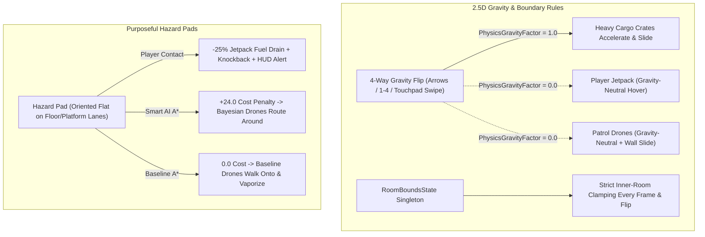

# Gravity Drift — 2.5D Antigravity Puzzle-Action & Bayesian Drone AI

**Gravity Drift** is a goal-driven 2.5D antigravity puzzle-action prototype built in **Unity 6.6 (`6000.6.10f1`)**, Universal Render Pipeline (URP 17.6), Unity Entities (`com.unity.entities` 6.6.0), and Unity Physics (`com.unity.physics` 6.6.0).

The game pairs **gravity-neutral 2.5D jetpack locomotion** (with red-blinking overload cooldown feedback) and **4-way cargo-crate gravity shifting** (with directional camera bounce bumps and intensity-scaled 2D screen shake), purposeful floor/lane **hazard pads**, interactive **sliding airlock objectives**, **progressive procedural level generation (PCG)** (capped at $1.5\times$ Level 1 arena size), **explicit Bayesian Posterior ($\pi$) patrol drone AI** with cross-level crate-dodge/escape learning, a dual-mode **Cel-Shaded & Painterly** URP shader, and native support for **PlayStation / DualSense Touchpad Swipe + Synced Rumble/Haptics (`DualSenseGamepadHID`)** alongside **PC Keyboard/Mouse testing**.

---

## 1. Gravity Rules, Boundary Clamping & Hazard Pads



### 1.1 Gravity Isolation & Strict Inner-Room Clamping
- **Crates-Only Gravity ([GravitySystem.cs](file:///D:/Unity%20Projects/GravityDash/Assets/Scripts/ECS/Systems/GravitySystem.cs), [GravityDriftBootstrap.cs](file:///D:/Unity%20Projects/GravityDash/Assets/Scripts/ECS/GravityDriftBootstrap.cs)):** Both the Player (`PlayerAuthoring`) and Patrol Drones (`DroneAuthoring`) carry `PhysicsGravityFactor { Value = 0f }` and remain gravity-neutral across all 4 cardinal gravity shifts. Only dynamic `cargo_crate` blocks carry `PhysicsGravityFactor = 1f`, turning gravity flips into pure environmental physics manipulation (clearing lanes or smashing into/crushing drones).
- **Dynamic `RoomBoundsState` Clamping:** `PCGRoomGenerator` syncs exact inner playable dimensions (`InnerMinX..InnerMaxX`, `InnerMinY..InnerMaxY`) to `RoomBoundsState` and `GridAStar`. Every simulation frame and gravity flip clamps position and zeroes outward velocity inside the room perimeter walls so neither player nor drones can ever clip or drift out of bounds.

### 1.2 Purposeful Hazard Pads
- **Correct Surface-Lane Orientation ([PCGRoomGenerator.cs](file:///D:/Unity%20Projects/GravityDash/Assets/Scripts/PCG/PCGRoomGenerator.cs)):** `hazard_pad.glb` meshes sit flat (`Euler(90, 0, 0)`) flush on top of floor and platform lanes with matching local trigger `BoxCollider` bounds and amber warning point lights.
- **Gameplay & AI Cost Coupling:** Touching a hazard pad drains **25% Jetpack Fuel**, applies a knockback impulse (`7.5 m/s`), and triggers a HUD `[HAZARD SHOCK!]` warning. In [GridAStar.cs](file:///D:/Unity%20Projects/GravityDash/Assets/Scripts/ECS/Pathfinding/GridAStar.cs), smart Bayesian drones assign `+24.0` traversal cost to hazard tiles and route cleanly around them, whereas Baseline drones assign `0.0` cost and walk into hazards.

---

## 2. Explicit Bayesian Posterior ($\pi$) & Cross-Level Drone Learning

Each smart drone maintains an explicit two-step Bayesian filter over discrete grid states $s_i \in \{1,\dots,W \times H\}$, explicitly coupling sensor observations $o_t$, **player actions** $a^{\text{player}}_t \in \{\text{Idle}, \text{JetpackThrust}, \text{JetpackBoost}, \text{GravityFlip}, \text{ObjectivePush}, \text{CrateAttack}\}$, **drone actions** $a^{\text{drone}}_t \in \{\text{Patrol}, \text{GravityShift}, \text{Reorient}, \text{Pursue}, \text{EvadeCrateDodge}\}$, and global gravity $g_t$:

$$\pi_t(s_i) = P\left(s_i \mid o_{1:t}, a^{\text{player}}_{1:t}, a^{\text{drone}}_{1:t}\right) = \frac{P\left(o_t \mid s_i, a^{\text{player}}_t, a^{\text{drone}}_t\right) \sum_{j} T\left(s_i \mid s_j, a^{\text{drone}}_t, \text{gravity}_t\right)\,\pi_{t-1}(s_j)}{\sum_{k} P\left(o_t \mid s_k, a^{\text{player}}_t, a^{\text{drone}}_t\right) \sum_{j} T\left(s_k \mid s_j, a^{\text{drone}}_t, \text{gravity}_t\right)\,\pi_{t-1}(s_j)}$$

- **Prediction Step ($\bar{\pi}_t$):** [DroneAISystem.cs](file:///D:/Unity%20Projects/GravityDash/Assets/Scripts/ECS/Systems/DroneAISystem.cs) computes `PredictedProbability` $\bar{\pi}_t(s_i)$ across walkable neighbor transitions $T(s_i \mid s_j, a^{\text{drone}}_t, g_t)$, modulating self-persistence by $a^{\text{drone}}_t$ and diffusing uncertainty downstream along `gravity_t` during flips.
- **Measurement Update ($\pi_t$):** Observation likelihood sharpens around high-energy player actions (`JetpackBoost`, `CrateAttack`), incorporates objective attraction around unflipped switches during `ObjectivePush`, attenuates empty close-scanned cells (`* 0.10`), normalizes by partition $Z_t$, and extracts `TopClusterConfidence` ($3 \times 3$ posterior mass around MAP $s^*$) and Shannon Entropy $H(\pi_t)$.
- **Crate-Dodge & Escape Adaptation (`DroneLearningState`):** Drones anticipate fast-moving incoming crates (`CrateDodgeSkill` scales `0.15 -> 0.95`), execute perpendicular `EvadeCrateDodge` impulses, lower trap-detection latency (`0.80s -> 0.20s`), and amplify escape thrust (`1.0x -> 2.8x`) across levels.

---

## 3. Per-Level Progression Chart & Telemetry Results


*Chart generated by [ProgressionChartExporter.cs](file:///D:/Unity%20Projects/GravityDash/Assets/Scripts/Editor/ProgressionChartExporter.cs) (`GravityDrift -> Run Benchmark & Export Progression Chart`) directly from [GravityDrift_Level_Progression.csv](file:///D:/Unity%20Projects/GravityDash/Telemetry/GravityDrift_Level_Progression.csv).*

### Per-Level Progression Data (`Level 1` $\to$ `Level 6`)

| Level | Drones | Arena Size | Posterior $\pi$ Confidence | Crate-Dodge Success | Avg Crate-Escape Time | Smart Player Attacks | Drone AI Improvement |
| :---: | :---: | :---: | :---: | :---: | :---: | :---: | :---: |
| **1** | 1 | `20x12` | `77.95%` | `45.45%` | `1.67 s` | `8` | `+28.71%` |
| **2** | 2 | `22x13` | `77.94%` | `50.00%` | `1.45 s` | `10` | `+39.42%` |
| **3** | 2 | `24x14` | `86.51%` | `54.55%` | `1.15 s` | `11` | `+50.13%` |
| **4** | 3 | `26x15` | `88.27%` | `81.82%` | `0.99 s` | `16` | `+70.84%` |
| **5** | 3 | `28x16` | `92.29%` | `78.79%` | `0.83 s` | `15` | `+78.22%` |
| **6** | 3 | `30x17` | `97.50%` | `87.88%` | `0.71 s` | `17` | `+90.93%` |

- **100-Trial Baseline Comparison ([GravityDrift_Benchmark_Telemetry.csv](file:///D:/Unity%20Projects/GravityDash/Telemetry/GravityDrift_Benchmark_Telemetry.csv)):** Multi-seed trials compare `Baseline` (no hazard awareness, no Bayesian posterior, no crate-dodge adaptation) vs. `Bayesian_FSM_AStar` across sub-millisecond Grid A* replanning.

---

## 4. Controls, Game-Feel Feedback & PlayStation DualSense Touchpad + Haptics

### Dual Control Scheme (PlayStation DualSense + PC Testing)

| Action | PlayStation / DualSense (`DualSenseGamepadHID`) | PC Keyboard / Mouse |
| :--- | :--- | :--- |
| **Jetpack Thrust (2D Hover)** | **Left Stick** | `W`, `A`, `S`, `D` |
| **Jetpack Boost** | **`R2` (Right Trigger)** / `R1` | `Left Shift` / `Space` |
| **4-Way Crate Gravity Flip** | **`Touchpad Swipe`** (0.25s anti-jitter cooldown), **`D-Pad`**, **`Face Buttons`**, or **R-Stick Flick** | `Arrow Keys` or `1`, `2`, `3`, `4` |
| **Pause / Resume Menu** | **`Options`** | `Escape` |
| **Cycle PCG Seeds** | Pause Menu (`NEW SEED`) | `N` (Next Seed) / `P` (Previous Seed) |
| **Switch Shader Style** | Settings Menu Toggle | `C` (Cel-Shaded) / `V` (Painterly) |
| **Debug Overlay ($\pi$ & A\*)** | **`Create` / Share Button** | `Tab` |
| **Run Benchmark + CSV** | Unity Menu (`GravityDrift -> Run Benchmark`) | `B` |

### Synced DualSense Touchpad, Haptics & Visual Feedback
- **DualSense Touchpad Swipe ([DualSenseTouchpadReader.cs](file:///D:/Unity%20Projects/GravityDash/Assets/Scripts/DebugAndTelemetry/DualSenseInput/DualSenseTouchpadReader.cs)):** Parses finger-0 touchpad coordinates directly from USB (`64B`) and Bluetooth (`78B`) `DualSenseGamepadHID` reports (plus child `Vector2Control`, Touchpad Click + Pointer drag under Steam Input wrappers, D-Pad, Face Buttons, and Right Stick flick fallbacks), converting deliberate directional swipes (`0.25s` cooldown) into 4-way gravity shifts + directional camera bounce bumps.
- **Unified Rumble & Lightbar Controller ([HapticFeedbackSystem.cs](file:///D:/Unity%20Projects/GravityDash/Assets/Scripts/DebugAndTelemetry/HapticFeedbackSystem.cs)):** Sends atomic `SetMotorSpeedsAndLightBarColor` commands on DualSense (and `SetMotorSpeeds` on standard gamepads), with toggle + intensity multiplier in Settings:
  - **Jetpack Thrust & Boost:** Continuous thruster hum (`0.12 / 0.25`), scaling up during `R2`/`Shift` boost (`0.30 / 0.55`), cutting off immediately when idle.
  - **Overload Red-Blink Lockstep:** When jetpack fuel depletes (`IsInCooldown`), pulses strong rhythmic rumble bursts (`0.85 / 0.75`) and flashing red lightbar LED **in lockstep** with the player shader's blinking red glow (`~11 Hz`) until cooldown completes.
  - **Camera Shake Trauma Coupling:** Mirrors 2D X/Y shake decay from [CameraFeedbackController.cs](file:///D:/Unity%20Projects/GravityDash/Assets/Scripts/DebugAndTelemetry/CameraFeedbackController.cs) (`0.5` crate-crush drone impact -> medium-heavy burst; `1.0` player hazard hit or caught -> max low/high rumble decay).
  - **Zero-Motor Safety:** Automatically executes `SetMotorSpeeds(0f, 0f)` on Pause (`Esc`/`Options`), Main Menu, Settings toggle OFF, `OnDisable()`, and `OnApplicationQuit()`.
- **Future-Minimalist uGUI Architecture ([GameUIManager.cs](file:///D:/Unity%20Projects/GravityDash/Assets/Scripts/DebugAndTelemetry/GameUIManager.cs), [GravityDriftUIBuilder.cs](file:///D:/Unity%20Projects/GravityDash/Assets/Scripts/DebugAndTelemetry/GravityDriftUIBuilder.cs)):** Replaced legacy IMGUI with responsive `1920x1080` `ScaleWithScreenSize` uGUI Canvas (`16:9` & `16:10` safe anchoring), duotone carbon/slate surfaces (`#0B0E14`, `#141923`, `#1E2633`, `#2A3444` 1px hairline borders), `#38BDF8` sky-blue accents, `#EF4444` overload/hazard alerts, `Aerodome` / TextMeshPro tabular typography, Bottom Tactical Strip (Jetpack fuel gauge + animated 4-way Gravity Vector arrow), and non-overlapping Bottom-Left [DebugOverlay.cs](file:///D:/Unity%20Projects/GravityDash/Assets/Scripts/DebugAndTelemetry/DebugOverlay.cs).

---

## 5. Codebase Architecture & Portfolio Notes

```
Assets/Scripts/
├── DebugAndTelemetry/
│   ├── DualSenseInput/
│   │   ├── DualSenseInput.asmdef       # Isolated unsafe HID assembly for DualSense touchpad
│   │   └── DualSenseTouchpadReader.cs  # USB/BT DualSense touchpad swipe + Steam Input fallback
│   ├── BenchmarkSystem.cs              # Bayesian per-level evaluator & 100-trial CSV exporter
│   ├── CameraFeedbackController.cs     # 2D screen shake (0.5 / 1.0) & gravity-shift bounce spring
│   ├── DebugOverlay.cs                 # Tab/Create overlay for grid, A* paths, pi heatmap & actions
│   ├── GameHUD.cs                      # HUD host
│   ├── GameUIManager.cs                # Future-minimalist uGUI menus, HUD & ECS bindings
│   ├── GravityDriftUIBuilder.cs        # Duotone palette tokens, 1px borders & uGUI builders
│   ├── HapticFeedbackSystem.cs         # Unified DualSense rumble + lightbar feedback bridge
│   ├── InputHelper.cs                  # PlayStation DualSense (Touchpad/D-Pad/L-Stick) + PC testing
│   └── StyleManager.cs                 # Cel-Shaded (C) vs Painterly (V) shader switcher
├── ECS/
│   ├── Authoring/                      # PlayerAuthoring, DroneAuthoring, StationKitAuthoring
│   ├── Components/                     # BayesianBeliefComponent, CameraFeedbackState, RoomBoundsState
│   ├── Pathfinding/                    # GridAStar.cs (dynamic bounds + +24.0 hazard cost penalty)
│   ├── Systems/                        # GravitySystem, PlayerMovementSystem, DroneAISystem, ObjectiveSystem
│   └── GravityDriftBootstrap.cs        # Pure ECS sync, crate-only gravity & red overload blinking VFX
├── Editor/
│   ├── ProgressionChartExporter.cs     # Exports Telemetry/GravityDrift_PerLevel_Improvement.png
│   └── RoomBuilder.cs                  # Rebuilds clean GravityDrift_Room.unity test scene
└── PCG/
    └── PCGRoomGenerator.cs             # Clean teardown, <=1.5x scaling, BFS check & camera framing
```
